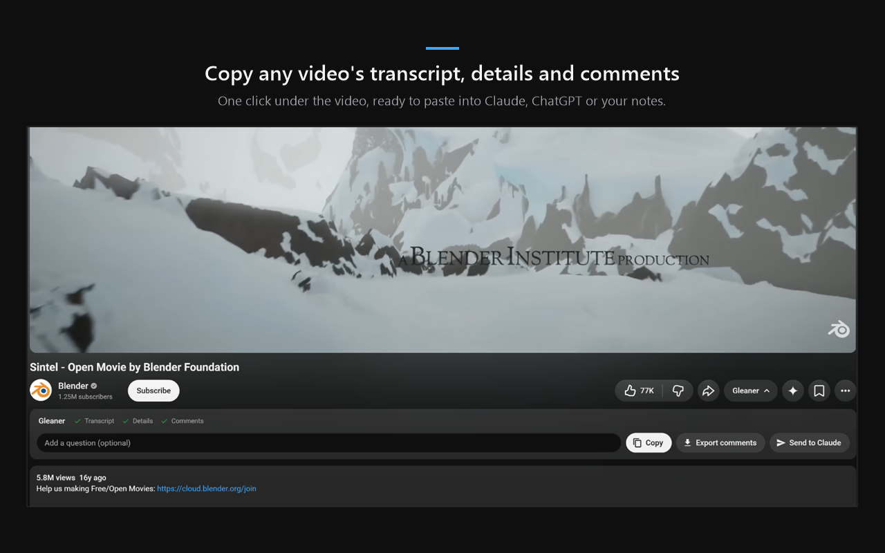
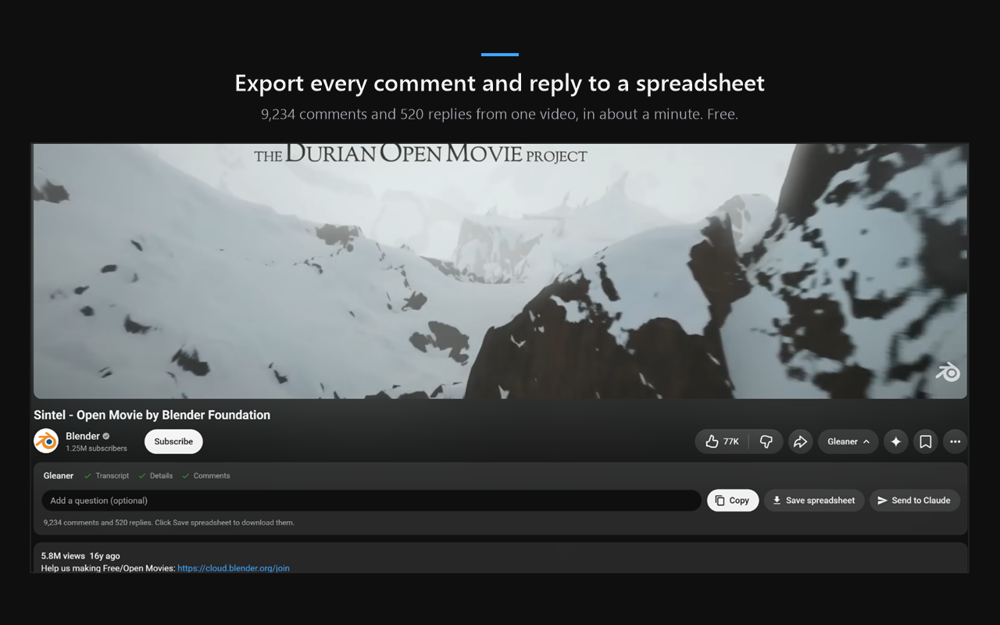

# Gleaner

Copy any YouTube video's transcript, details and comments for your AI in one click, send it all to Claude, or export every comment to a spreadsheet. Free and open source.

## What it does
- **Copy**: one block of text with the video's details (title, channel, date, views, likes, tags, description, chapters), the full transcript with timestamps, and up to 320 top comments with their replies. If you type a question, it goes at the end.
- **Send to Claude**: opens claude.ai in Chrome's side panel, next to the video, and sends it everything, in your own Claude account.
- **Export comments**: every comment and every reply on a video, however many there are, as a CSV file for Excel, Google Sheets or Numbers. Each reply sits under the comment it answers. A huge video takes hours, so Stop pauses it anytime: Save spreadsheet gives you what has loaded so far, and Continue carries on.
- **Shorts**: a button on Shorts opens the Short as a normal video with the panel ready.

No API key, no account, no servers and no tracking.

## Install
It isn't on the Chrome Web Store yet. To load it from this code (Chrome 116 or newer):
1. Download this repository (Code, then Download ZIP) and unzip it, or clone it.
2. Open `chrome://extensions` and turn on Developer mode.
3. Click Load unpacked and pick the folder.

The folder loads as the developer build, called Scribe: Enter in the question box sends to Claude, and a few test hooks work. For the Gleaner build that goes to the store, run `node tools/build-store.js` (needs Node.js) and load `dist/store` instead.

## How it works
- `content.js` runs inside YouTube's own page (`"world": "MAIN"`) so it can read the player. It gets the transcript by catching the player's own caption request (if captions are off, it turns them on for a moment and back off), reads the details from the player and the page, and reads comments through the same endpoint the page uses.
- `relay.js` passes messages between the page and the rest of the extension.
- `background.js` opens the side panel for Send. While the panel is open, a session rule lets claude.ai load inside it; the rule only matches frames outside browser tabs, so no website can frame claude.ai because of it.
- `sidepanel.html` and `sidepanel.js` show a fresh claude.ai chat. `ai-inject.js` runs in that frame only: it pastes the video as an attachment, puts your question in the message box and presses send.
- Export reads YouTube's "Newest first" order, because "Top comments" stops near 1,000 on big videos.

## Privacy
Gleaner reads the video page you open it on and nothing else. It has no servers, ads, analytics or tracking. The only time anything leaves your browser is Send to Claude, and that goes to your own Claude account. Full policy: https://sites.google.com/view/gleaner-extension/privacy

## License
MIT (see [LICENSE](LICENSE)): do whatever you want with it, including changing it, sharing it and selling it. Just keep the license notice in your copy. It comes as is, with no warranty.

Gleaner isn't made by, endorsed by or affiliated with YouTube, Google or Anthropic.

Contact: shudder-thrum.9i@icloud.com
